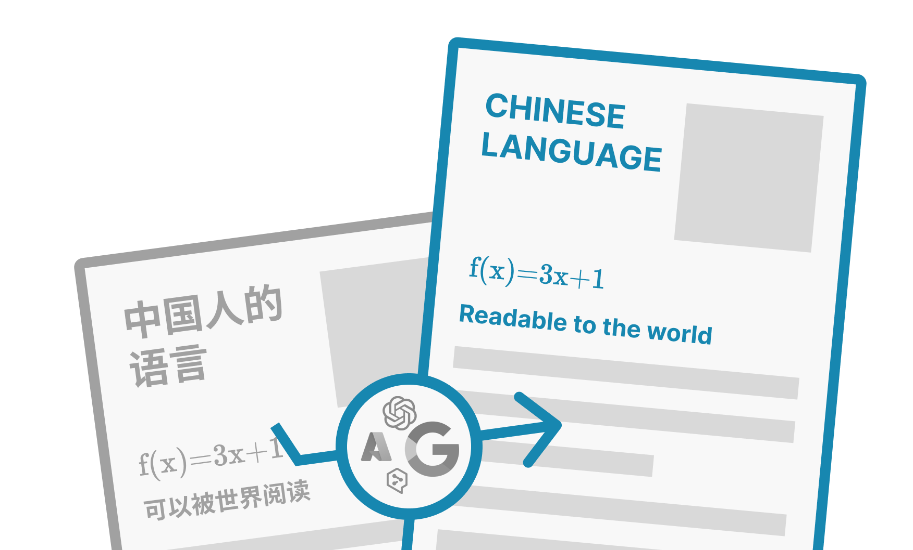
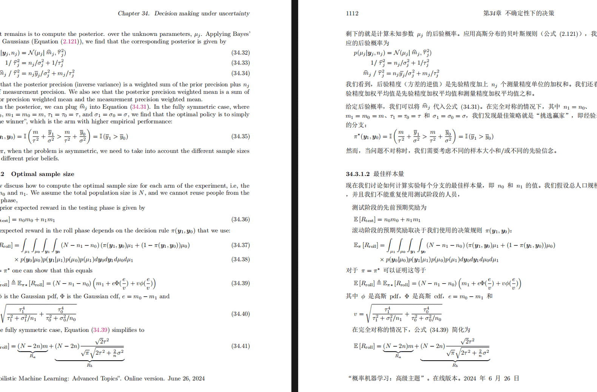
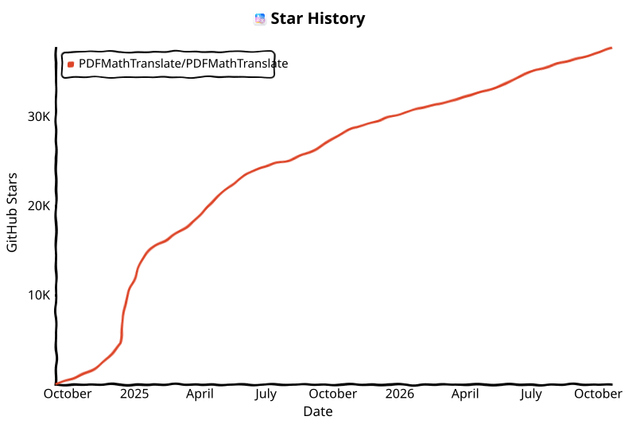

<div align="center">

English | [简体中文](docs/README_zh-CN.md) | [繁體中文](docs/README_zh-TW.md) | [日本語](docs/README_ja-JP.md) | [한국어](docs/README_ko-KR.md)



<h2 id="title">PDFMathTranslate</h2>

<p>
  <!-- PyPI -->
  <a href="https://pypi.org/project/pdf2zh/">
    </a>
  <a href="https://pepy.tech/projects/pdf2zh">
    </a>
  <a href="https://hub.docker.com/r/byaidu/pdf2zh">
    </a>
  <a href="https://hellogithub.com/repository/8ec2cfd3ef744762bf531232fa32bc47" target="_blank"></a>
  <a href="https://gitcode.com/Byaidu/PDFMathTranslate/overview">
    </a>
  <a href="https://huggingface.co/spaces/reycn/PDFMathTranslate-Docker">
    </a>
  <a href="https://www.modelscope.cn/studios/AI-ModelScope/PDFMathTranslate">
    </a>
  <a href="https://github.com/Byaidu/PDFMathTranslate/pulls">
    </a>
  <a href="https://t.me/+Z9_SgnxmsmA5NzBl">
    </a>
  <!-- License -->
  <a href="./LICENSE">
    </a>
</p>

<a href="https://trendshift.io/repositories/19816" target="_blank"></a>

</div>

<h2 id="what">1. What is PDFMathTranslate?</h2>

Scientific PDF translation that preserves formulas, charts, tables of contents and annotations.

This repository is the **unified entry point** of the PDFMathTranslate ecosystem: one package with a command line tool, a Python API and an MCP server, running either of two translation kernels. Apps and plugins build on it instead of forking it.

<div align="center">

</div>

<h2 id="choose">2. Pick the right tool</h2>

| I want to… | Use |
| --- | --- |
| Read and translate papers in a desktop or mobile app | **[PDFMathReader](https://github.com/PDFMathTranslate/PDFMathReader)** — the official client for macOS, Windows, Linux and [iOS](https://github.com/PDFMathTranslate/PDFMathReader-iOS) |
| Translate online or in the browser, without installing anything | **[Immersive Translate · BabelDOC](https://app.immersivetranslate.com/babel-doc/)** — free monthly quota |
| Translate inside Zotero | **[zotero-pdf2zh](https://github.com/guaguastandup/zotero-pdf2zh)** |
| Let an AI agent (Claude, DeepSeek Harness, …) translate PDFs | **`pdf2zh --mcp`** from this repository — see [MCP](#mcp) |
| Use the command line, call it from Python, or self-host | **This repository** — read on |

<h3 id="ecosystem">How the projects fit together</h3>

```
BabelDOC (layout engine, by funstory.ai)         pdf2zh v1 pipeline
                 \                               /
          babeldoc kernel (optional)        legacy kernel (default)
                          \                   /
         PDFMathTranslate: pdf2zh CLI · Python API · MCP   <- this repository
                 |                 |                  |
          PDFMathReader      zotero-pdf2zh     AI agents / dsh plugins
```

<h2 id="install">3. Install and use</h2>

Requires Python 3.11 to 3.14; the BabelDOC kernel needs 3.11 to 3.13.

```bash
pip install pdf2zh                # CLI, Python API, legacy kernel (+ BabelDOC on 3.11-3.13)
pdf2zh document.pdf               # writes document-mono.pdf and document-dual.pdf
```

Optional extras:

| Extra | Adds |
| --- | --- |
| `pdf2zh[ultrafast]`, `pdf2zh[ocr]` | [Ultrafast mode](./docs/ADVANCED.md#ultrafast) and [automatic OCR](./docs/ADVANCED.md#ocr) for the legacy kernel |
| `pdf2zh[mcp]` | The MCP server (`pdf2zh --mcp`) |
| `pdf2zh[gui]` | The Gradio web UI (`pdf2zh -i`) |
| `pdf2zh[backend]` | The Flask/Celery HTTP backend ([API details](./docs/APIS.md#api-http)) |

Docker images with the web UI: `docker run -d -p 7860:7860 byaidu/pdf2zh`, also on [GitHub Container Registry](https://github.com/Byaidu/PDFMathTranslate/pkgs/container/pdfmathtranslate).

<details>
<summary>Network issues when downloading models</summary>

Both kernels download a layout model from Hugging Face on first use. If that fails in your region, set a mirror:

```bash
export HF_ENDPOINT=https://hf-mirror.com
```

See the [FAQ](https://github.com/Byaidu/PDFMathTranslate/wiki#-faq--%E5%B8%B8%E8%A7%81%E9%97%AE%E9%A2%98) for other problems.
</details>

<h3 id="kernels">3.1 Kernels</h3>

| Kernel | Install | Best for |
| --- | --- | --- |
| `legacy` (default) | included | The pdf2zh v1 pipeline: lighter, runs on Python 3.14; ultrafast mode, OCR and custom ONNX models |
| `babeldoc` | included | Higher layout fidelity, powered by [BabelDOC](https://github.com/funstory-ai/BabelDOC); Python 3.11 to 3.13 |

`--kernel auto` (the default) uses legacy, and BabelDOC only when legacy is unavailable; pass `--kernel babeldoc` to use BabelDOC. `--mode fast` / `--mode precise` and `--babeldoc` still work as aliases. See [Choose a kernel](./docs/ADVANCED.md#kernel).

<h3 id="usage">3.2 Command line</h3>

```bash
pdf2zh paper.pdf -li en -lo ja -s deepl          # source/target language and service
pdf2zh paper.pdf -s openai:gpt-4o-mini -p 1-3    # service:model, partial translation
pdf2zh paper.pdf --kernel legacy --ultrafast     # legacy kernel, native-text fast path
pdf2zh --dir ./papers -o ./out                   # batch translate a folder
```

| Option | Function |
| --- | --- |
| `files` | Local files or URLs |
| `-k`, `--kernel` | `auto`, `babeldoc` or `legacy` |
| `-li`, `-lo` | [Source and target language](./docs/ADVANCED.md#language) |
| `-s` | [Translation service](./docs/ADVANCED.md#services), optionally `service:model` |
| `-p` | [Pages](./docs/ADVANCED.md#partial), e.g. `1,3-5` |
| `-o` | Output directory |
| `-t` | [Threads](./docs/ADVANCED.md#threads) |
| `-f`, `-c` | [Formula font / character regex](./docs/ADVANCED.md#exceptions) |
| `--prompt` | [Custom prompt](./docs/ADVANCED.md#prompt) |
| `--config` | [Configuration file](./docs/ADVANCED.md#cofig) |
| `--ignore-cache` | [Bypass the translation cache](./docs/ADVANCED.md#cache) |
| `--ultrafast`, `--onnx`, `--skip-subset-fonts` | Legacy kernel options |
| `-i`, `--flask`, `--celery` | Web UI and HTTP backend (legacy kernel) |
| `--mcp`, `--sse` | [MCP server](#mcp) |
| `--json` | Print one JSON line with the output paths on stdout, for programs that run pdf2zh |
| `--worker` | Stay running and take JSON translation requests on stdin, for plugins ([protocol](./examples/README.md#pdf2zh---worker)) |

All options are described in [Advanced Usage](./docs/ADVANCED.md).

<h3 id="python">3.3 Python API</h3>

```python
from pdf2zh import TranslateRequest, get_kernel

kernel = get_kernel()                     # "auto", "babeldoc" or "legacy"
request = TranslateRequest(files=["paper.pdf"], lang_in="en", lang_out="zh", service="google")
for result in kernel.translate(request):  # or: await kernel.translate_async(request)
    print(result.mono_pdf, result.dual_pdf)
```

`pdf2zh.translate` and `pdf2zh.translate_stream` remain available for the legacy kernel; see [API Details](./docs/APIS.md).

<h3 id="mcp">3.4 MCP</h3>

Register pdf2zh in any MCP host. The host starts it on demand; nothing has to be kept running:

```json
{
  "mcpServers": {
    "pdf2zh": {
      "command": "uvx",
      "args": ["--from", "pdf2zh[mcp]", "pdf2zh", "--mcp"]
    }
  }
}
```

Tools: `translate_pdf(file, lang_in, lang_out, service, kernel, pages, output_dir)`, `list_kernels()` and `open_pdf_reader(file, ...)`. In hosts that support [MCP Apps](https://modelcontextprotocol.io/docs/extensions/apps) (Claude, ChatGPT), `open_pdf_reader` shows the PDF in the conversation and translates pages as you scroll. Details in [MCP](./docs/ADVANCED.md#mcp).

<h3 id="examples">3.5 Build on pdf2zh</h3>

[`examples/`](./examples/) has working starting points: a [web frontend and server](./examples/server/) with REST, live progress and remote MCP, and integrations for [Claude](./examples/claude/), [ChatGPT](./examples/chatgpt/), [Zotero](./examples/zotero/) and [DeepSeek Harness](./examples/dsh/).

<h2 id="updates">4. Recent updates</h2>

- [October 2026] PDFMathTranslate becomes the unified entry point: BabelDOC runs in-process as an optional kernel next to the default `legacy` kernel (the v1 pipeline), the MCP server gains kernel, service and page selection, and the GUI and HTTP backend move to extras. The `pdf2zh_next` submodule is removed.
- [October 3, 2026] Spaces between adjacent CJK and Latin letters in the legacy kernel.
- [October 2, 2026] `--ultrafast` mode for native-text PDFs (by [@reycn](https://github.com/reycn)).
- [September 8, 2026] Experimental OCR with paragraph regrouping and adaptive typesetting (by [@reycn](https://github.com/reycn)).

<h2 id="information">5. Project Information</h2>
<h3 id="citation">5.1 Citation</h3>

This work has been accepted by the [*Proceedings of the 2025 Conference on Empirical Methods in Natural Language Processing: System Demonstrations*](https://aclanthology.org/2025.emnlp-demos.71/) (EMNLP 2025). 

Citation:

```
@inproceedings{ouyang-etal-2025-pdfmathtranslate,
	    title = "{PDFM}ath{T}ranslate: Scientific Document Translation Preserving Layouts",
	    author = "Ouyang, Rongxin  and
	      Chu, Chang  and
	      Xin, Zhikuang  and
	      Ma, Xiangyao",
	    editor = {Habernal, Ivan  and
	      Schulam, Peter  and
	      Tiedemann, J{\"o}rg},
	    booktitle = "Proceedings of the 2025 Conference on Empirical Methods in Natural Language Processing: System Demonstrations",
	    month = nov,
	    year = "2025",
	    address = "Suzhou, China",
	    publisher = "Association for Computational Linguistics",
	    url = "https://aclanthology.org/2025.emnlp-demos.71/",
	    pages = "918--924",
	    ISBN = "979-8-89176-334-0",
	    abstract = "Language barriers in scientific documents hinder the diffusion and development of science and technologies. However, prior efforts in translating such documents largely overlooked the information in layouts. To bridge the gap, we introduce PDFMathTranslate, the world{'}s first open-source software for translating scientific documents while preserving layouts. Leveraging the most recent advances in large language models and precise layout detection, we contribute to the community with key improvements in precision, flexibility, and efficiency. The work is open-sourced at https://github.com/byaidu/pdfmathtranslate with more than 222k downloads."
	}
```
<h3 id="acknowledgement">5.2 Acknowledgement</h3>

- [Immersive Translation](https://immersivetranslate.com) sponsors monthly Pro membership redemption codes for active contributors to this project, see details at: [CONTRIBUTOR_REWARD.md](https://github.com/funstory-ai/BabelDOC/blob/main/docs/CONTRIBUTOR_REWARD.md)

- New backend: [BabelDOC](https://github.com/funstory-ai/BabelDOC)

- Document merging: [PyMuPDF](https://github.com/pymupdf/PyMuPDF)

- Document parsing: [Pdfminer.six](https://github.com/pdfminer/pdfminer.six)

- Document extraction: [MinerU](https://github.com/opendatalab/MinerU)

- Document Preview: [Gradio PDF](https://github.com/freddyaboulton/gradio-pdf)

- Multi-threaded translation: [MathTranslate](https://github.com/SUSYUSTC/MathTranslate)

- Layout parsing: [DocLayout-YOLO](https://github.com/opendatalab/DocLayout-YOLO)

- Document standard: [PDF Explained](https://zxyle.github.io/PDF-Explained/), [PDF Cheat Sheets](https://pdfa.org/resource/pdf-cheat-sheets/)

- Multilingual Font: [Go Noto Universal](https://github.com/satbyy/go-noto-universal)

<h3 id="contrib">5.3 Contributors</h3>

<a href="https://github.com/Byaidu/PDFMathTranslate/graphs/contributors">
  
</a>


For details on how to contribute, please consult the [Contribution Guide](https://github.com/Byaidu/PDFMathTranslate/wiki/Contribution-Guide---%E8%B4%A1%E7%8C%AE%E6%8C%87%E5%8D%97).


<h3 id="star_hist">5.4 Star History</h3>
<!-- star-history:start -->
<picture>
  <source media="(prefers-color-scheme: dark)" srcset="assets/star-history/star-history-dark.svg">
  
</picture>
<!-- star-history:end -->
